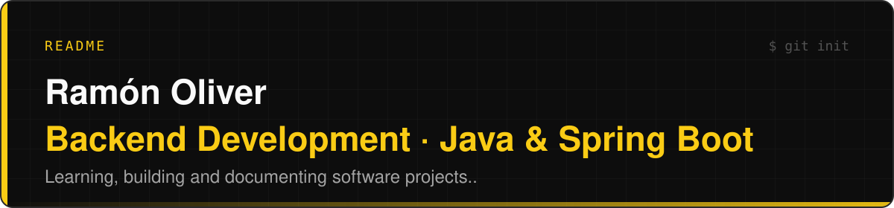

## About Me

Career changer moving into backend development. Currently enrolled in the Java Backend (Spring Boot) bootcamp at IT Academy, Barcelona.

Two years into programming, I still find myself getting into a state of flow. That's a big part of why I'm making this switch.

I started with a full-stack PHP/Laravel bootcamp at IT Academy in 2025. My growing interest in data structures, software architecture and security led me toward Java and backend development.

## Sobre mí

Estoy reorientando mi carrera profesional hacia el desarrollo backend. Actualmente curso el bootcamp de Java Backend (Spring Boot) en IT Academy, Barcelona.

Después de dos años programando, sigo experimentando algo muy parecido al estado de flujo cuando me enfrento a un problema de programación. Esa es una de las principales razones por las que he decidido dar este giro profesional.

Comencé con un bootcamp de desarrollo full-stack con PHP/Laravel en IT Academy en 2025. Mi creciente interés por las estructuras de datos, la arquitectura de software y la seguridad informática me llevó a buscar una especialización en Java y desarrollo backend.

## Currently Building

### Travel Planner — Early-stage Development

A REST API for planning and organizing trips, integrating external location data through Geoapify.

**Planned tech stack:** Java · Spring Boot · PostgreSQL

The project focuses on:

- Itinerary modeling and trip organization.

- REST API design and external API integration.

- Database persistence and data modeling.

- Maintainable architecture and software design patterns.

## Currently Learning

**Computer Science:** Data Structures · Design Patterns · Software Security

**Backend & Databases:** Spring Boot · PostgreSQL · MongoDB

**Development Tools:** OpenCode · GitHub Actions

**AI-Assisted Development:** AI Agents · Agent Skills · Model Context Protocol (MCP) · Automation · Spec-Driven Development (SDD)

## Contact

[ramonolivermartos@gmail.com](mailto:ramonolivermartos@gmail.com)

---

<!--
**ramonolivermartos/ramonolivermartos** is a ✨ _special_ ✨ repository because its `README.md` (this file) appears on your GitHub profile.

Here are some ideas to get you started:

- 🔭 I’m currently working on ...
- 🌱 I’m currently learning ...
- 👯 I’m looking to collaborate on ...
- 🤔 I’m looking for help with ...
- 💬 Ask me about ...
- 📫 How to reach me: ...
- 😄 Pronouns: ...
- ⚡ Fun fact: ...
-->
